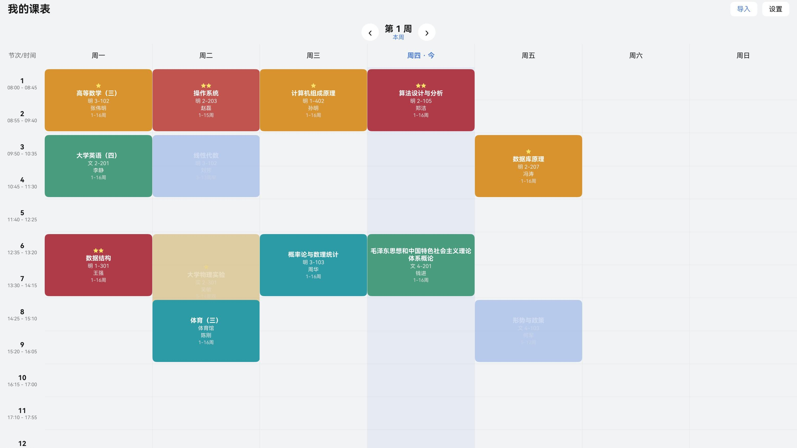
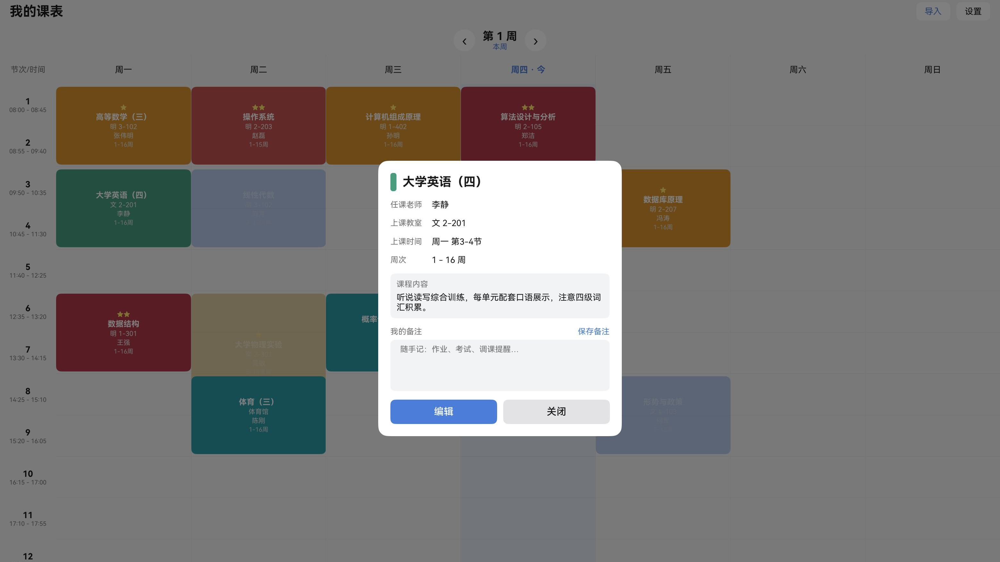

# 杉课 Shanke

<p align="center">
  
</p>

**杉课** 是一款专为 HarmonyOS PC / 2in1 大屏原生打造的课程表应用，已上架华为应用市场（HarmonyOS NEXT）。

课表图片一拍，即变结构化周视图 —— 支持**离线 OCR 图片识别**、**Excel / CSV 文件导入**、手动添加三种方式建表，数据全部本地存储，**零权限、零联网、纯离线可用**。

<p align="center">
  
  &nbsp;
  
</p>

## 功能特性

- **离线图片识别导入**：调用系统端侧 OCR（Core Vision Kit），课表截图 / 拍照免登录自动解析，数据不出设备
- **多格式文件导入**：教务系统导出的 xlsx / CSV 课表文件直接解析成结构化课程
- **重要程度分色**：按课程重要程度三色渲染课表格子，本周重点一眼锁定
- **大屏原生周视图**：全宽七列网格 + 节次时间轴 + 本周高亮，为键鼠大屏场景设计
- **课程详情与自定义备注**：任科老师、课程内容、独立自定义备注，编辑后实时刷新
- **灵活配置**：节次时间、学期起点自由设置，当前周次自动推算

## 技术要点

| 模块 | 实现 |
|------|------|
| UI 框架 | ArkTS / ArkUI 声明式开发，Navigation 导航，原生适配 2in1 大屏 |
| 文字识别 | Core Vision Kit 端侧 OCR（免权限、纯离线） |
| 文件解析 | 自研 xlsx 解析器（zlib 解压 + XML 解析，零第三方依赖）+ CSV 解析 |
| 数据存储 | relationalStore 本地数据库（WAL 模式），支持字段自动迁移 |
| 状态管理 | AppStorage 跨页面数据联动，导入 / 编辑后界面即时刷新 |

## 构建

```bash
# DevEco Studio 打开工程后，或命令行：
hvigorw.js assembleHap --mode module -p product=default -p buildMode=release
```

- IDE：DevEco Studio（HarmonyOS SDK，API 24+）
- 设备：HarmonyOS PC / 2in1（华为 MateBook Pro 等）

## 相关材料

- [月度星光应用申报材料](docs/杉课-月度星光应用申报材料.pptx)
- [OH 创新大赛赛道三作品提交材料](docs/杉课-OH大赛赛道三作品提交.pptx)
- [隐私政策（线上公示版）](http://101.132.89.216/privacy.html)

## 作者

孙涵韬（独立开发） · 上海杉达学院 · 指导老师：祝欣蓉
